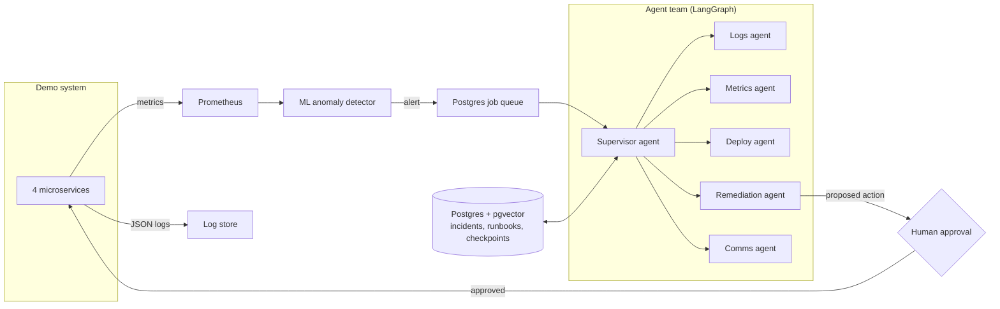

<div align="center">

# Vigil

**The AI on-call engineer that never sleeps.**

A multi-agent system that detects production incidents with machine learning, investigates them
with a team of LLM agents, and fixes them only after a human approves.

[](https://github.com/Amann001/vigil/actions/workflows/ci.yml)

[](LICENSE)


</div>

---

## The problem

When a production system breaks, an on-call engineer is paged, often in the middle of the night,
and spends a long time reading logs, checking dashboards and hunting for the change that caused it.
Every minute of that investigation is downtime.

## What Vigil does

1. **Detects** problems with a trained anomaly detection model instead of fixed alert thresholds.
2. **Investigates** with a team of specialised agents coordinated by a supervisor:
   logs, metrics and recent deployments are examined in parallel.
3. **Remembers** past incidents and runbooks, and retrieves the relevant ones by meaning.
4. **Proposes a fix** and **asks a human** before taking any action that changes the system.
5. **Writes the incident report** once the system has recovered.

## Architecture



## Design principles

- **Read freely, write with permission.** Agents can inspect anything; every action that changes the
  system requires human approval.
- **Durable by default.** Every agent step is checkpointed, so an investigation resumes after a crash.
- **Measured, not assumed.** Every component is evaluated, including on public benchmarks.
- **Runs on free tiers.** No paid services, and under 5 GB of local disk.

## Evaluation (planned)

| What | How |
|---|---|
| Incident diagnosis | 20 injected failure types, 6 of them held out until the final evaluation |
| Metrics | Root-cause accuracy, time to diagnosis, tokens per incident, unsafe-action rate |
| Anomaly detection | Precision, recall and detection delay, including on the Numenta Anomaly Benchmark (NAB) |
| Log parsing | Parsing accuracy on LogHub datasets |
| Ablations | Single agent vs multi-agent, with vs without memory, model vs model |

Results will be published here as they are produced.

## Tech stack

| Area | Technology |
|---|---|
| Agent orchestration | LangGraph |
| LLMs | Google Gemini, Groq (provider-agnostic) |
| Database, vector memory, checkpoints | PostgreSQL + pgvector |
| ML | scikit-learn, ONNX Runtime, Drain3, fastembed |
| Observability | Prometheus, structured JSON logs, Langfuse |
| API | FastAPI |

## Getting started

Requires [uv](https://docs.astral.sh/uv/).

```bash
git clone https://github.com/Amann001/vigil.git
cd vigil
uv sync
uv run pytest

# Download Prometheus (pinned version, SHA-256 verified) into bin/
uv run python scripts/install_prometheus.py
```

Each demo shop service can be started on its own, e.g. `uv run python -m shop.inventory`:

| Service | Port | Role |
|---|---|---|
| storefront | 8000 | Public API: product listing and checkout |
| orders | 8001 | Reserves stock, charges payment, rolls back on failure |
| payments | 8002 | Simulated card processor with realistic latency and declines |
| inventory | 8003 | Stock levels with periodic restocking |

Every service exposes `/health`, `/metrics` (Prometheus) and writes structured JSON logs to
`data/logs/`. Prometheus scrapes all four every 5 seconds using
[monitoring/prometheus.yml](monitoring/prometheus.yml).

## Roadmap

Vigil is under active development. See [docs/ROADMAP.md](docs/ROADMAP.md) for the milestones.

## License

[MIT](LICENSE)
