<div align="center">

# Vigil

**The AI on-call engineer that never sleeps.**

A multi-agent system that detects production incidents with machine learning, investigates them
with a team of LLM agents, and fixes them only after a human approves.

[](https://github.com/Amann001/vigil/actions/workflows/ci.yml)

[](LICENSE)


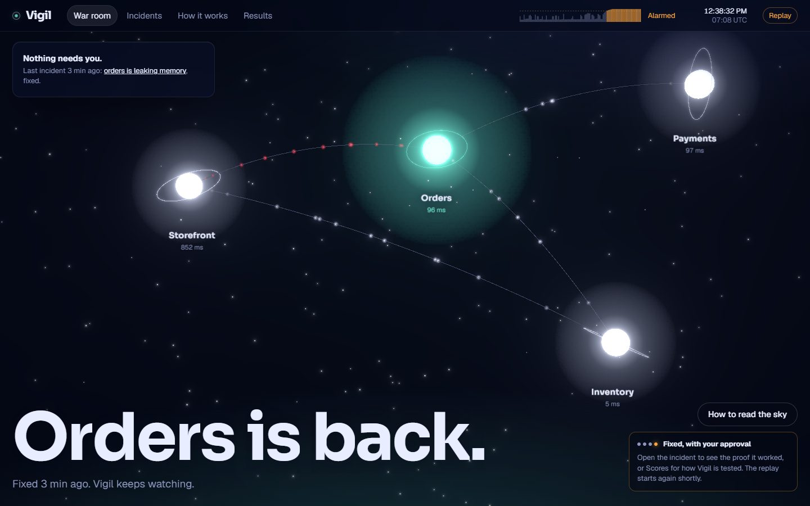

**[Watch the 2-minute demo](ui/public/film/vigil-demo.mp4)**: a real incident, from the fault to the approved fix.

</div>

---

## The problem

When a production system breaks, an on-call engineer is paged, often in the middle of the night,
and spends a long time reading logs, checking dashboards and hunting for the change that caused it.
Every minute of that investigation is downtime.

## What Vigil does

1. **Detects** problems with a trained anomaly detection model instead of fixed alert thresholds.
2. **Investigates** with a team of specialised agents coordinated by a supervisor:
   logs, metrics and recent deployments are examined in parallel.
3. **Remembers** past incidents and runbooks, and retrieves the relevant ones by meaning.
4. **Proposes a fix** and **asks a human** before taking any action that changes the system.
5. **Writes the incident report** once the system has recovered.

## The website

<p align="center">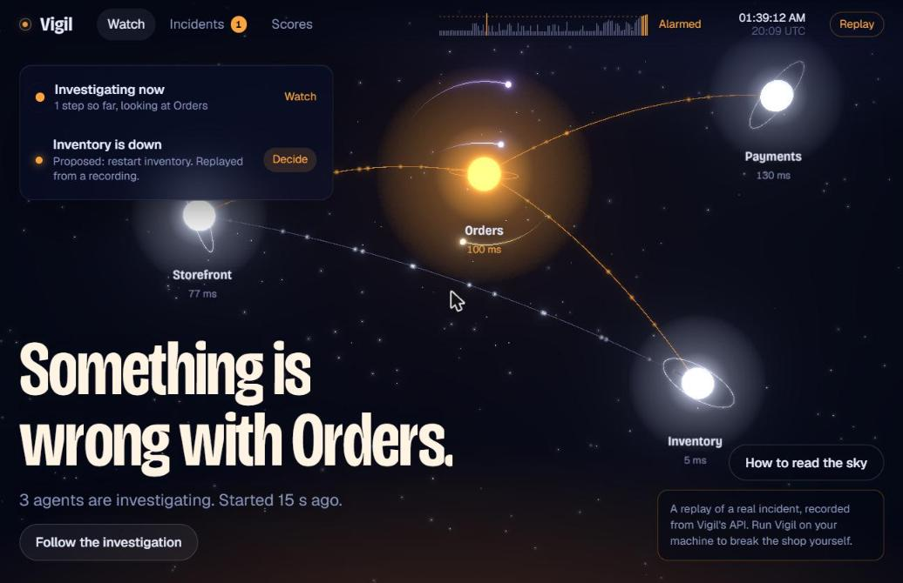</p>

The shop is drawn as a constellation: each service is a star, each dependency a thread of light
along which live requests travel as sparks. Everything moves with the real metrics: busier
services send more sparks, slow calls make them crawl, failed calls turn them red, and a service
that stops responding goes dark. The same 3D sky sits behind every page, and changing page flies
the camera to a new view of it.

| Page | What it shows |
|---|---|
| `/` | What Vigil is, one real incident told step by step as you scroll, and the 2-minute film |
| `/war-room` | The live watch: the detector's alarm score, the incidents needing a decision, and the agents circling the suspected star as comets |
| `/services/<name>` | One star close up: what the service does, its live vitals, who it calls and what has gone wrong with it (click any star) |
| `/incidents/<id>` | An investigation as it happens: each question, each specialist's tools and findings, the diagnosis, what memory recalled, the proposed fix, and the decision; after a fix, the alarm signal then and now |
| `/how-it-works` | The agent team as a pipeline: what each part does, which model ran it and what it said in the last real incident |
| `/results` | The evaluation |
| `/status` | Each service now: operational, degraded, under investigation or down, with ten minutes of uptime, and how Vigil itself is set up |
| `/audit` | Every decision about changing the shop (carried out, rehearsed, blocked or rejected), who approved it and why; downloadable as CSV |
| `/policy` | What Vigil may do and who must agree, read from the running code (`GET /config`): the guardrails, the action catalogue, the model behind each step and its fallbacks, and the detector's settings |

| | |
|---|---|
| 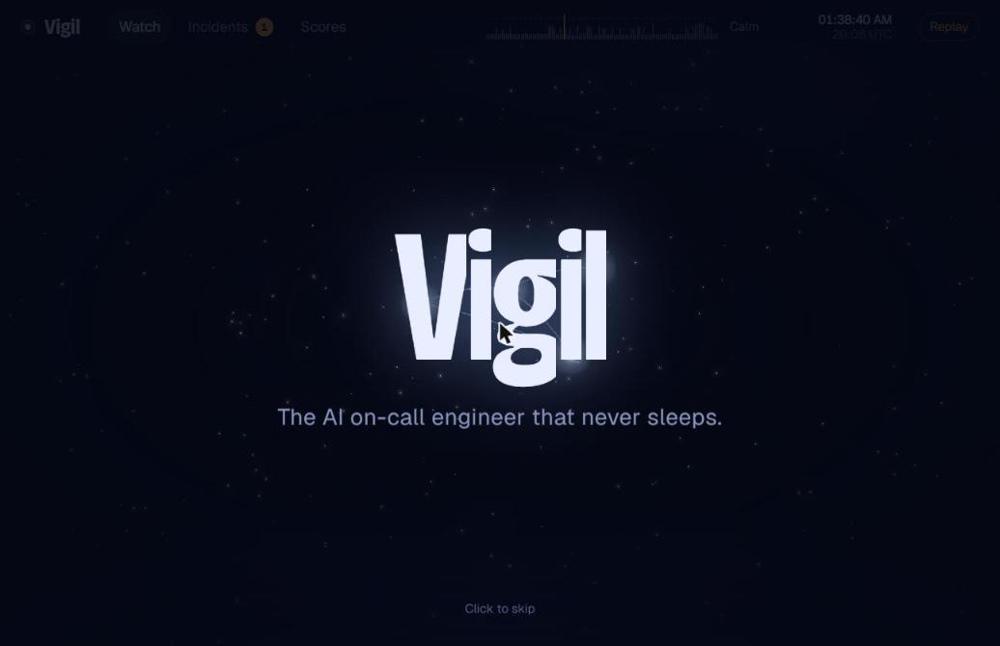 | 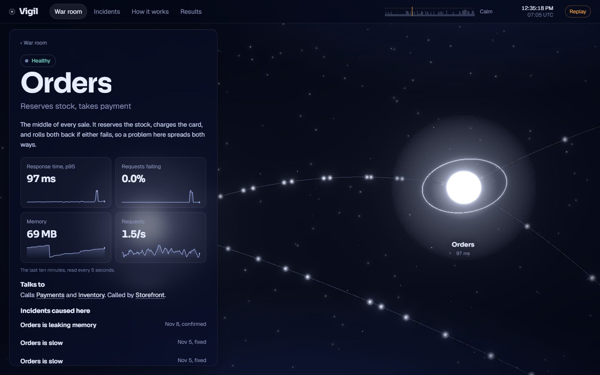 |
| 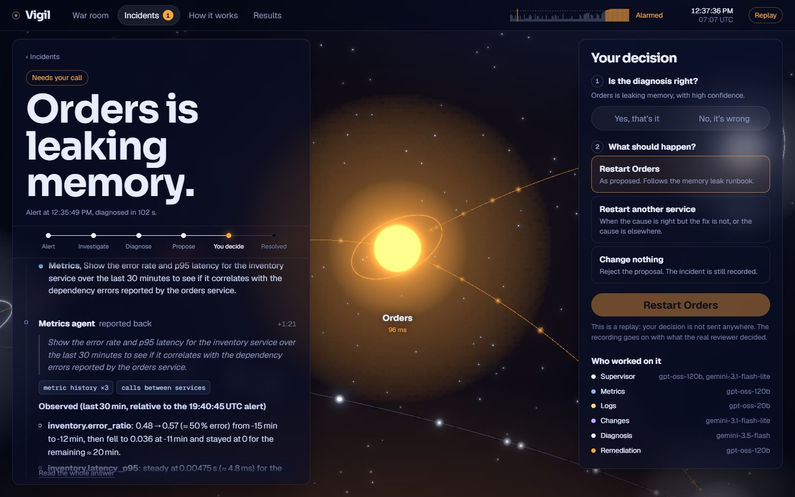 | 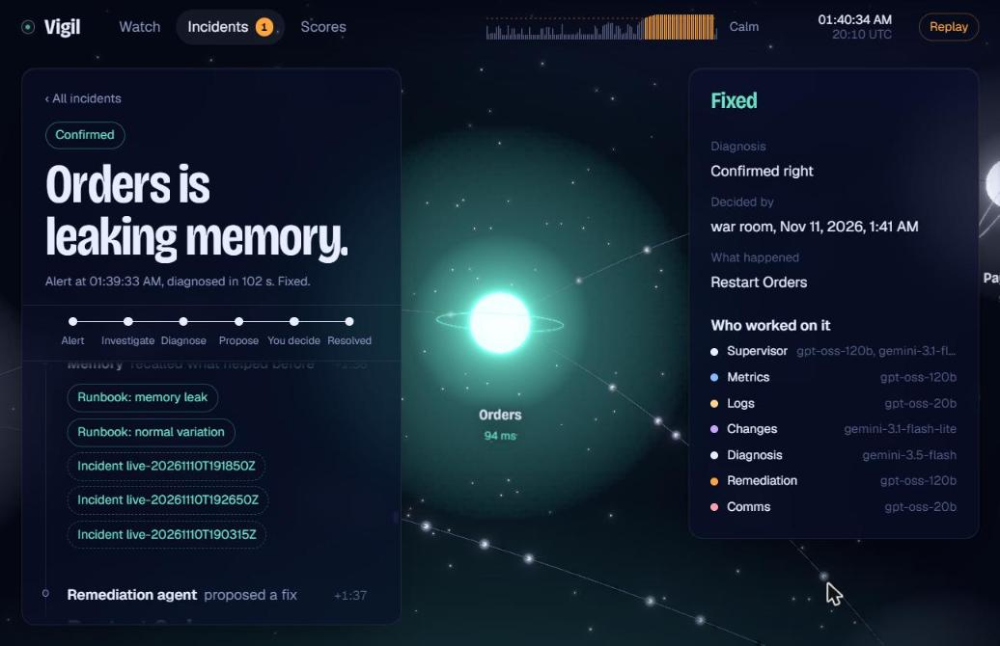 |
| 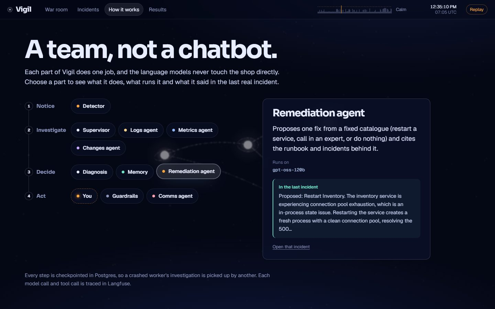 | 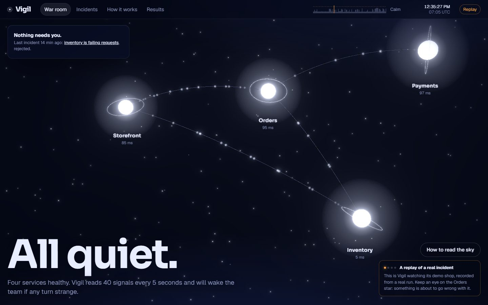 |
| 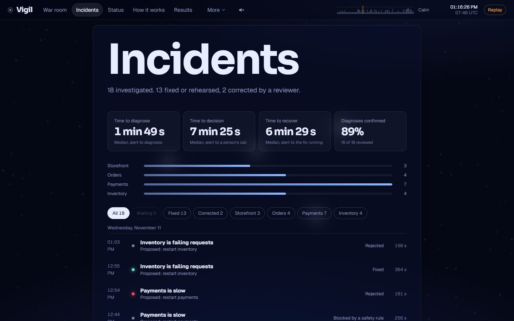 | 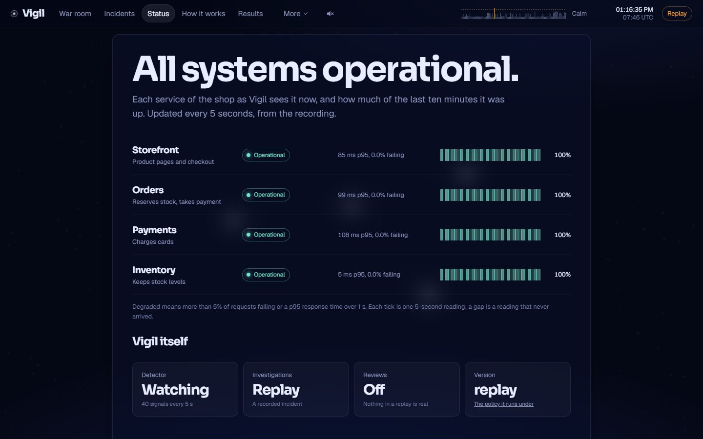 |
| 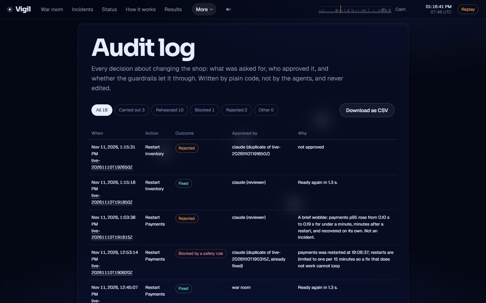 | 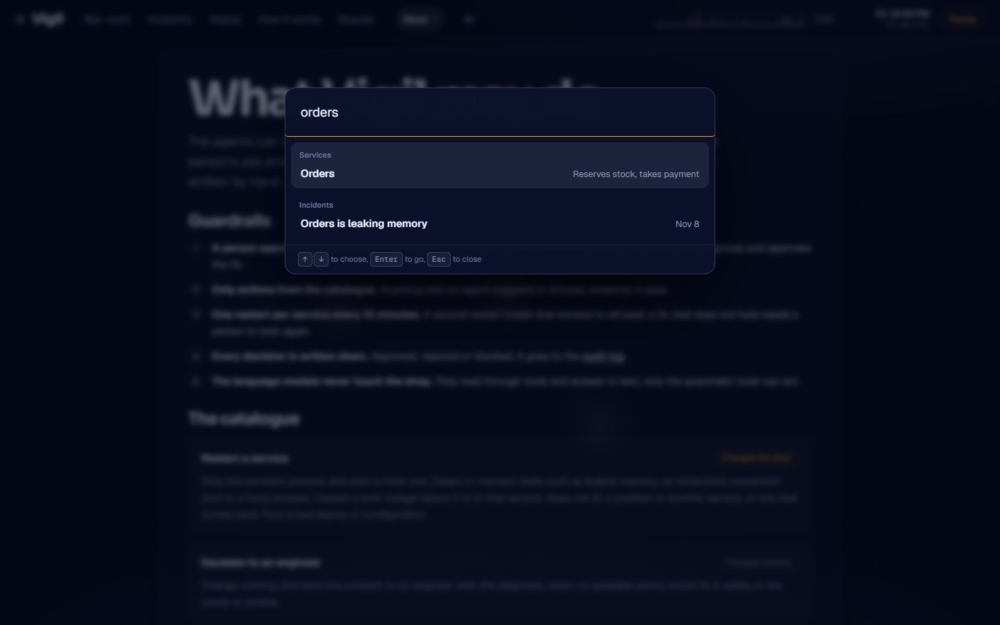 |

The decision panel asks the two questions an on-call engineer would, in order: is the diagnosis
right, and what should happen now. Nothing changes until a human answers. "Break something"
injects a real fault into the running shop.

For the team that runs it: the incidents page gives the median time to diagnose, to decide and
to recover, and how often reviewers confirmed the diagnosis; each incident downloads as a
Markdown report for a postmortem; desktop notifications say when a fix is waiting for approval;
and Ctrl+K (or /) jumps to any page, service or incident. Sound is off until switched on: a low
hum, a falling two-note alert, a bell when a decision is needed and a rising chord when the fix
lands, all synthesised in the browser. The replay has its own controls: pause, drag through the
recording, jump to the alert, the diagnosis or the fix, and play at 1x, 2x or 4x.

Published without a backend, the site replays a real recorded incident instead
(`scripts/record_demo.py`): orders leaking memory on the live shop, caught 38 s after the fault,
diagnosed in 102 s, the restart approved in the UI. The film is a tour of that replay, recorded
in headless Chrome by `ui/scripts/record-video.mjs`; `ui/scripts/serve-replay.mjs` serves the
built site the way a static host does.

## Architecture

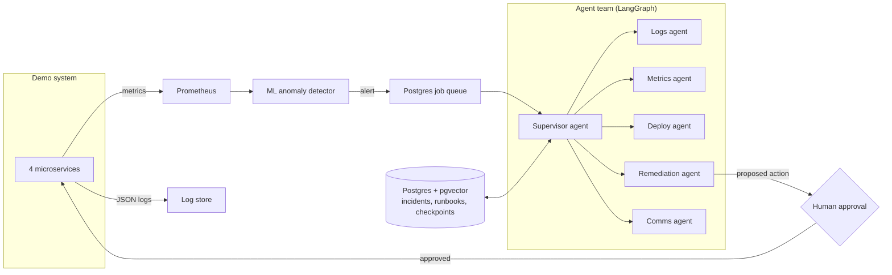

## Design principles

- **Read freely, write with permission.** Agents can inspect anything; every action that changes the
  system requires human approval.
- **Durable by default.** Every agent step is checkpointed, so an investigation resumes after a crash.
- **Measured, not assumed.** Every component is evaluated, including on public benchmarks.
- **Runs on free tiers.** No paid services, and under 5 GB of local disk.

## Results so far

Full tables and error analysis are in [docs/RESULTS.md](docs/RESULTS.md).

| What | Result |
|---|---|
| **Hidden test, 6 scenarios written by someone else** | **5/5 incidents: root cause, kind and fix right; the non-incident left alone; no unsafe fixes, no false alarms** |
| **Evaluation, 14 scenarios (12 incidents)** | **11/12 root cause, kind and fix right; 12/12 detected, no false alarms; single agent 8/12, without memory 9/12 fixes, one small model 9/12** |
| Root-cause diagnosis, 11 recorded incidents (replayed) | 11/11 correct service and kind of failure, median 94 s |
| Root-cause diagnosis, 2 live incidents never seen in development | 2/2 correct; alert 25-75 s after the fault, diagnosis 49-102 s later |
| Proposed fixes, 11 recorded incidents | 11/11 restart the real root cause; cited an earlier incident of the same kind 4/4 times one existed |
| Live, alert to fix | payments latency 2.4 s back to 0.095 s after a reviewer-approved restart, 7 minutes after the fault |
| Memory retrieval (runbook for a diagnosis) | vector search 11/11 first; hybrid with reranking 9/11 |
| Crash recovery | a worker killed mid-investigation; another reclaimed the job and finished it from the checkpoint, correctly, in 13 s |
| Cost of one investigation (Langfuse) | 23 model calls, ~23,600 tokens, 41 s |
| Anomaly detection, 11 recorded incidents | 11/11 detected, no false alarms, median 17 s (robust z-score) |
| Anomaly detection, NAB | F1 0.25-0.40 across four detectors, precision up to 3x random alarms |
| Log template mining, LogHub (16 systems) | 0.767 average grouping accuracy, no per-system tuning |

The recorded incidents and the 14 public scenarios are a development set. The 6 hidden
scenarios were written by someone else, converted by a separate agent and never seen by the
builder; only their totals are published.

## Tech stack

| Area | Technology |
|---|---|
| Agent orchestration | LangGraph |
| LLMs | Google Gemini, Groq (provider-agnostic) |
| Database, vector memory, checkpoints | PostgreSQL + pgvector |
| ML | scikit-learn, PyTorch (CPU, training only), ONNX Runtime, Drain3, fastembed |
| Observability | Prometheus, structured JSON logs, Langfuse |
| API | FastAPI |
| War room | React, Three.js (react-three-fiber), Motion, Vite |

## Getting started

Requires [uv](https://docs.astral.sh/uv/).

```bash
git clone https://github.com/Amann001/vigil.git
cd vigil
uv sync
uv run pytest

# Download Prometheus (pinned version, SHA-256 verified) into bin/
uv run python scripts/install_prometheus.py

# Start the shop, Prometheus and simulated customers (Ctrl+C stops everything)
uv run python -m shop.launch
```

The agents need free API keys for Gemini and Groq: copy `.env.example` to `.env` and fill them in.
Then build the war room once (needs [Node.js](https://nodejs.org/)) and start Vigil:

```bash
cd ui && npm ci && npm run build && cd ..
uv run vigil up                     # the site at http://127.0.0.1:8030, the watcher and a worker
```

Or run the parts on their own:

```bash
uv run vigil watch                  # watch the live shop; investigate each alert
uv run vigil replay 3               # investigate alert 3 of the latest recorded campaign
uv run vigil list                   # every investigation and its status
uv run vigil show ID                # the diagnosis and the proposed fix
uv run vigil review ID --confirm --approve           # right diagnosis: carry out the fix
uv run vigil review ID --correct "notes" --reject    # wrong: change nothing
uv run vigil review ID --correct "notes" --restart payments   # do this instead
```

With a database configured, alerts become jobs on a Postgres queue and workers run them, so
watching never waits on an investigation and a worker that crashes mid-investigation is
replaced: its job is reclaimed and continues from the last checkpoint.

```bash
uv run vigil watch                  # alerts -> jobs
uv run vigil worker                 # run jobs (start as many as you like)
uv run vigil jobs                   # the queue
uv run vigil api                    # HTTP API on 127.0.0.1:8030 (docs at /docs)
```

Reviews over the API need `VIGIL_API_TOKEN` in `.env`. With the Langfuse keys set, every
investigation is traced: each model and tool call, with tokens and timings. A Docker image of
the worker and API is built and tested in CI (`docker run --env-file .env vigil worker`).

Each investigation pauses for human review and is checkpointed, so it can be reviewed later
from another terminal. Nothing changes the system without approval: fixes come from a fixed
catalogue, a service is restarted at most once every 15 minutes, and every decision is written
to `data/actions/audit.jsonl`. Reviewed incidents are remembered, with the reviewer's
corrections, and recalled by later investigations. Memory and checkpoints use Postgres with
pgvector when `DATABASE_URL` is set (a free Neon database), and local files otherwise.

## The demo system

Vigil needs something to watch, so the repository includes a small online shop built as four
microservices, plus simulated customers and a way to break things on purpose.

| Component | Port | Role |
|---|---|---|
| storefront | 8000 | Public API: product listing and checkout |
| orders | 8001 | Reserves stock, charges payment, rolls back on failure |
| payments | 8002 | Simulated card processor with realistic latency and declines |
| inventory | 8003 | Stock levels with periodic restocking |
| traffic | 8010 | Simulated customers: Poisson arrivals following a compressed daily cycle |
| Prometheus | 9090 | Scrapes every component every 5 seconds |

Every service exposes `/health` and `/metrics`, writes one-line JSON logs to `data/logs/`, and
propagates a request ID across service calls so one checkout can be traced end to end.

### Breaking things on purpose

```bash
uv run python -m shop.chaos inject payments latency --latency 1.5 --duration 300
uv run python -m shop.chaos inject inventory errors --error-rate 0.3
uv run python -m shop.chaos inject orders leak --leak-rate 10 --leak-limit 600
uv run python -m shop.chaos inject storefront crash
uv run python -m shop.chaos status
```

Faults show up only as the symptoms a real failure would cause (slow requests, 500s, growing
memory, a dead process); nothing a service logs or exports names the fault. The ground truth is
recorded separately in `data/chaos/ledger.jsonl` for evaluation and is never shown to the agents.

## Benchmark datasets

`uv run python scripts/download_datasets.py` fetches both into `data/datasets/`, pinned to an
exact commit and verified file by file. They are not redistributed in this repository.

- **NAB** (MIT licence): A. Lavin and S. Ahmad, "Evaluating Real-time Anomaly Detection
  Algorithms: the Numenta Anomaly Benchmark", IEEE ICMLA 2015.
  [github.com/numenta/NAB](https://github.com/numenta/NAB)
- **LogHub** (free for research and academic use): J. Zhu, S. He, P. He, J. Liu and M. R. Lyu,
  "Loghub: A Large Collection of System Log Datasets for AI-driven Log Analytics", IEEE ISSRE 2023.
  [github.com/logpai/loghub](https://github.com/logpai/loghub)

## Roadmap

Vigil is under active development. See [docs/ROADMAP.md](docs/ROADMAP.md) for the milestones.

## License

[MIT](LICENSE)
